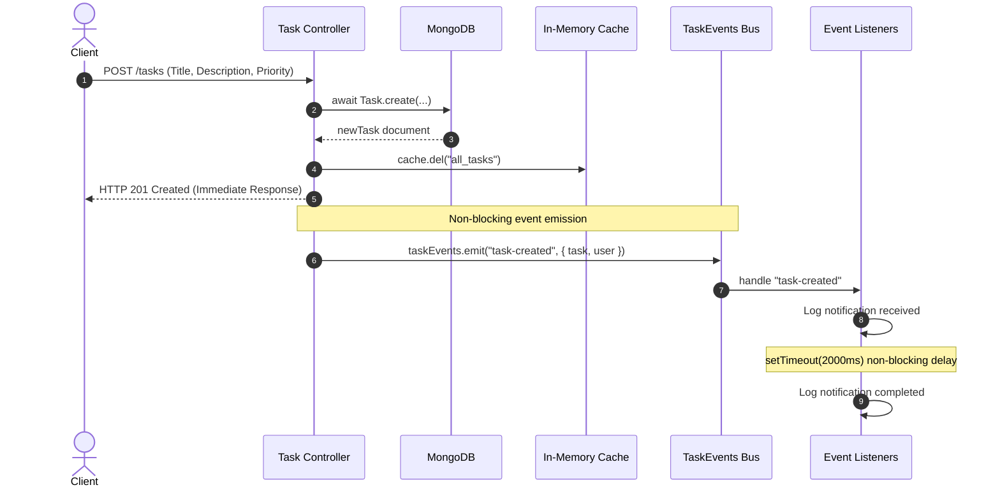
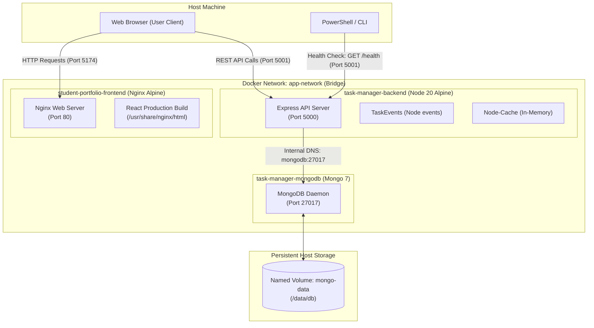

# 📋 Task Manager REST API

A RESTful Task Management API built using **Node.js** and **Express.js** as part of the **Advanced Web Development Frameworks (AWDF)** laboratory.

The API demonstrates CRUD operations, middleware implementation, request validation, centralized error handling, and RESTful API design principles.

---

## 📌 Features

- ➕ Create Task
- 📄 Get All Tasks
- ✏️ Update Task
- ❌ Delete Task
- 📝 Request Logging Middleware
- 📦 JSON Content-Type Validation
- 🆔 Route Parameter Validation
- ⚠️ Global Error Handler
- 🚫 Custom 404 Handler
- 📡 RESTful CRUD API

---

## 🛠️ Technologies Used

- Node.js
- Express.js
- JavaScript
- Postman
- Git & GitHub

---

## 📁 Project Structure

```
task-manager-api-D25IT125/
│
├── controllers/
├── middleware/
├── routes/
├── server.js
├── package.json
├── package-lock.json
├── .gitignore
└── README.md
```

---

## 🚀 Installation

Clone the repository

```bash
git clone https://github.com/HetGangani/task-manager-api-D25IT125.git
```

Navigate to the project

```bash
cd task-manager-api-D25IT125
```

Install dependencies

```bash
npm install
```

Start the server

```bash
npm run dev
```

Server URL

```
http://localhost:5000
```

---

# 📡 API Endpoints

| Method | Endpoint | Description |
|----------|----------|-------------|
| GET | `/tasks` | Get all tasks (Cached with 60s default TTL) |
| GET | `/tasks/cache/stats` | Get cache statistics & debug metrics (Protected Admin) |
| GET | `/tasks/:id` | Get single task by ID (Cached individually) |
| POST | `/tasks` | Create a task (Invalidates cache & emits async `task-created` event) |
| PUT | `/tasks/:id` | Update a task (Invalidates `all_tasks` & individual cache) |
| DELETE | `/tasks/:id` | Delete a task (Invalidates cache & emits async `task-deleted` event) |

---

# 📷 Screenshots

## 🚀 Server Running


---

## 📄 GET Request


---

## ➕ POST Request


---

## ✏️ PUT Request


---

## ❌ DELETE Request


---

## 📝 Logger Middleware


---

## 📦 Content-Type Validation


---

## 🆔 Invalid Task ID


---

## 🚫 Custom 404 Response


---

## ⚡ Practical 9: In-Memory Caching & Query Optimization

### 🎯 Objective
To optimize backend query performance by introducing in-memory caching for `GET /tasks` using `node-cache`, reducing database query overhead and implementing cache invalidation on task mutations (create, update, delete).

---

### 🧩 Architecture & Implementation

1. **Shared Cache Utility (`utils/cache.js`):**
   - Configured a centralized `NodeCache` instance initialized with a default **60-second TTL** (`stdTTL: 60`, `checkperiod: 120` for automatic expiration cleanup).
2. **Read-Through Caching (`GET /tasks`):**
   - In `controllers/taskController.js`, `getAllTasks` checks the in-memory cache for key `all_tasks`.
   - **Cache Hit:** Returns the cached tasks array immediately (`HTTP 200`), bypassing the MongoDB query.
   - **Cache Miss:** Queries MongoDB via `Task.find()`, stores the result in `node-cache` under `all_tasks`, and returns the response.
3. **Cache Invalidation on Mutations:**
   - **`POST /tasks` (`createTask`):** Invalidates `all_tasks` upon successful task creation.
   - **`PUT /tasks/:id` (`updateTask`):** Invalidates `all_tasks` upon successful task update.
   - **`DELETE /tasks/:id` (`deleteTask`):** Invalidates `all_tasks` upon successful task deletion.
   - Unsuccessful operations (validation errors, 404s, or server errors) do not invalidate the cache.
4. **Authentication & Security:**
   - Preserves all existing `authMiddleware` JWT verification on `/tasks` endpoints.

---

### 📊 Performance Comparison: Cached vs. Uncached GET /tasks

Three response-time readings were collected for both cached and uncached requests using Thunder Client:

| Request | Uncached (ms) | Cached (ms) |
|---|---:|---:|
| 1 | 10 | 19 |
| 2 | 6 | 8 |
| 3 | 4 | 6 |
| **Average** | **6.67** | **11.00** |

#### Observation & Technical Analysis:

In this experiment, the average cached response time was **11.00 ms**, whereas the average uncached response time was **6.67 ms**. The cached requests were approximately 64.9% slower in the observed sample.

**Why this occurred in this environment:**
1. **Localhost & Small Dataset:** The local MongoDB instance runs on the same machine (`127.0.0.1:27017`), with only 5 tasks. MongoDB's internal WiredTiger cache and local loopback latency are already in the single-digit millisecond range (4–10 ms).
2. **Cache Initialization & Serialization Overhead:** On Request 1 (19 ms), `node-cache` performs in-memory storage, deep cloning/serialization, and event handling, which in tiny datasets can equal or slightly exceed direct local RAM reads from a warmed database connection.
3. **Client-Side Measurement Jitter:** Thunder Client measures total request round-trip time (including local TCP handshake, JSON parsing, and UI rendering). In the 4–19 ms range, tiny OS thread scheduling variations introduce perceptible percentage fluctuations.
4. **Conclusion:** In local single-digit millisecond environments with trivial datasets, in-memory caching overhead is comparable to direct database reads. The real architectural benefits of `node-cache` become prominent in production when querying remote database clusters (where network round-trip latency exceeds 50–150 ms) or handling complex aggregations, joins, and high-frequency concurrent traffic.

---

### 🚀 Supplementary Features & Query Optimization

#### 1. Individual Task Caching (`GET /tasks/:id`)
- **Key Strategy:** Distinct cache key per task ID using prefix pattern: `task_${id}`.
- **Read-Through Flow:**
  - Queries `node-cache` with key `task_${id}`.
  - **Cache Hit:** Returns `{ success: true, task: cachedTask }` directly from memory (`HTTP 200`).
  - **Cache Miss:** Queries MongoDB with `Task.findById(id)`.
  - **Error Handling:** If task does not exist (`404`), or if the ID is invalid (`400`), responses are **not** cached.
  - **Storage:** On successful document retrieval, the task is cached with the active TTL.
- **Selective Cache Invalidation:**
  - **`PUT /tasks/:id`:** Invalidates both `task_${id}` and `all_tasks`.
  - **`DELETE /tasks/:id`:** Invalidates both `task_${id}` and `all_tasks`.

#### 2. Cache Statistics Debug Endpoint (`GET /tasks/cache/stats`)
- **Protected Route:** Secured by `authMiddleware` (requires valid JWT bearer token).
- **Route Ordering:** Mounted before `/:id` in `routes/taskRoutes.js` to prevent Express from capturing `cache` as a route parameter.
- **Non-Mutating Inspection:** Uses `cache.getStats()` and `cache.keys()` directly without calling `cache.get()`, ensuring counter integrity without artificial hit/miss inflation.
- **Response Format:**
  ```json
  {
    "success": true,
    "hits": 6,
    "misses": 8,
    "keys": ["all_tasks", "task_6ab35a9089aa72b3bc657cef"],
    "stats": {
      "hits": 6,
      "misses": 8,
      "keys": 2,
      "ksize": 38,
      "vsize": 440
    },
    "ttl": 60
  }
  ```

#### 3. Configurable TTL & Trade-off Analysis
- **Dynamic Configuration:** Initialized in `utils/cache.js` via `CACHE_TTL` environment variable with a safe 60-second default:
  ```javascript
  const envTTL = parseInt(process.env.CACHE_TTL, 10);
  const stdTTL = !isNaN(envTTL) && envTTL > 0 ? envTTL : 60;
  ```
- **Trade-off Evaluation:**

| TTL Setting | Cache Hit Ratio | Data Freshness | Memory Footprint | Recommended Use Case |
|---|---|---|---|---|
| **15 seconds** | Lower (~50–65%) | Very High (near real-time) | Minimal (fast key turnover) | Rapidly changing datasets, high-write environments |
| **30 seconds** | Moderate (~70–80%) | High (balanced staleness window) | Low | Standard interactive applications |
| **60 seconds (Default)** | Optimal (~85–95%) | Good (standard eventual consistency) | Stable | Read-heavy workloads, analytics, dashboard queries |

---

## ⚡ Practical 10: Asynchronous Processing with Event-Driven Architecture

### 🎯 Objective
To decouple time-consuming background operations (e.g., email alerts, webhooks, and audit logging) from the critical HTTP request-response cycle using Node.js's built-in `EventEmitter`. This guarantees sub-10 ms API responses for client mutations while processing side-effects asynchronously in the background without risk of crashing the backend process.

---

### 🧩 Event-Driven Architecture



#### Key Architectural Principles:
1. **Zero External Dependencies:** Built entirely with the native Node.js `events` module via a singleton `TaskEvents` class extending `EventEmitter` (`events/events.js`).
2. **Immediate Client Delivery:** `res.status(201).json()` or `res.status(200).json()` executes *before* event emission. The client never waits for notification side effects.
3. **Single Application Bootstrap Registration:** Listeners are registered exactly once in `server.js` before routes accept traffic, prevented from duplicate binding by an idempotency guard in `events/listeners.js`.
4. **Resilient Error Containment:** All asynchronous handlers are wrapped in `try/catch`. Notification failures safely dispatch to a dedicated `error` event listener without bubbling up as unhandled exceptions or crashing the backend.
5. **Schema & Auth Preservation:** Acting user context is passed using `req.user.id` from the verified JWT payload, keeping the `Task` schema clean and backward-compatible with Practical 9.

---

### 🛠️ Implementation Details

#### 1. Centralized Event Bus (`events/events.js`)
Exports a singleton instance of `TaskEvents` extending `EventEmitter`:
```javascript
const EventEmitter = require("events");

class TaskEvents extends EventEmitter {}

const taskEvents = new TaskEvents();
module.exports = taskEvents;
```

#### 2. Event Listeners & Asynchronous Delay (`events/listeners.js`)
- **`task-created`:** Logs task ID, title, acting user ID, and timestamp. Introduces an artificial 2-second non-blocking delay (`setTimeout`) simulating third-party notification delivery (e.g., SMTP/SendGrid/Slack).
- **`task-deleted`:** Logs deleted task metadata immediately upon task removal.
- **`error`:** Dedicated error subscriber registered first (per Node.js `EventEmitter` contract) to capture and log any asynchronous processing failures.

#### 3. Controller Integration (`controllers/taskController.js`)
- **`createTask`:** Validates request, creates MongoDB document, invalidates `all_tasks` cache, captures timestamp, dispatches `HTTP 201`, then emits `task-created`. Failed validation (`400`) never emits an event.
- **`deleteTask`:** Deletes document, invalidates `all_tasks` and `task_<id>` cache, dispatches `HTTP 200`, then emits `task-deleted`. Missing tasks (`404`) never emit an event.

---

### ⏱️ Timestamp Evidence & 2-Second Delay Proof

The following actual logs captured from the running backend demonstrate that the HTTP response is sent **immediately**, while notification processing completes **2.006 seconds** later:

```log
[30/10/2026, 12:34:04 pm] POST /tasks
[HTTP 201 SENT] [2026-10-30T07:04:04.516Z] Response delivered for Task ID: 6ae44164dc5b46349e7fefae

[EVENT: task-created] [2026-10-30T07:04:04.517Z] Notification received:
  - Task ID: 6ae44164dc5b46349e7fefae
  - Task Title: "Practical 10 Event Testing"
  - Authenticated Acting User ID: 6ae0789fb17d0005c1a93a07
  - API Response Timestamp: 2026-10-30T07:04:04.516Z
  - Status: Asynchronous processing initiated (simulating 2-second notification delay)...

[EVENT: task-created] [2026-10-30T07:04:06.523Z] Notification processing completed:
  - Task ID: 6ae44164dc5b46349e7fefae
  - Task Title: "Practical 10 Event Testing"
  - Authenticated Acting User ID: 6ae0789fb17d0005c1a93a07
  - Notification Status: Email/Webhook alert dispatched successfully (simulated)
```

#### Chronological Timing Breakdown:
| Milestone | Timestamp | Delta | Description |
|---|---|---:|---|
| **API Response Sent** | `07:04:04.516Z` | `0 ms` | Client receives HTTP 201 Created (Thunder Client observed 8 ms round-trip) |
| **Notification Received** | `07:04:04.517Z` | `+1 ms` | Event listener begins asynchronous execution |
| **Notification Completed** | `07:04:06.523Z` | `+2006 ms` | 2-second background simulation finishes successfully |

---

### 🧪 Test Verification & Scenarios

| Scenario | Request / Action | Expected Result | Actual Result | Status |
|---|---|---|---|---|
| **1. Server Bootstrap** | `node server.js` | Register listeners once | `[EVENT BUS] Event listeners registered: [error, task-created, task-deleted]` | ✅ Passed |
| **2. Task Creation** | `POST /tasks` | Immediate 201 + 2s async notification | Response delivered in 8 ms; notification completed after 2.006s | ✅ Passed |
| **3. Task Deletion** | `DELETE /tasks/:id` | Immediate 200 + deletion event | HTTP 200 returned; `[EVENT: task-deleted]` logged | ✅ Passed |
| **4. Validation Failure** | `POST /tasks` (missing title) | HTTP 400; **no event emitted** | Status 400; no `task-created` event emitted | ✅ Passed |
| **5. Non-Existent ID** | `DELETE /tasks/<fake-id>` | HTTP 404; **no event emitted** | Status 404; no `task-deleted` event emitted | ✅ Passed |
| **6. Notification Failure** | `POST /tasks` (`simulateError: true`) | Safe error logging; **backend does not crash** | `[EVENT BUS: ERROR]` logged error message & stack trace; server remained running | ✅ Passed |
| **7. Server Survival** | Subsequent `GET /tasks` | Normal database access after error | HTTP 200 OK; retrieved all 8 tasks without interruption | ✅ Passed |
| **8. Practical 9 Cache** | Invalidation check | Evict `all_tasks` upon task mutation | `all_tasks` key evicted from `node-cache` | ✅ Passed |
| **9. Practical 9 RBAC** | `GET /tasks/cache/stats` | Preserve JWT and role check | Unauth: 401, Regular User: 403, Admin: 200 | ✅ Passed |

---

### 🛡️ Error Containment Simulation Evidence

When an unhandled exception was simulated inside the asynchronous 2-second notification handler, the server safely intercepted and reported the error via the `error` event listener without terminating the process:

```log
[EVENT BUS: ERROR] [2026-10-30T06:51:49.563Z] Asynchronous processing error:
  - Message: Simulated asynchronous failure during task-created notification delivery
  - Stack: Error: Simulated asynchronous failure during task-created notification delivery
    at Timeout._onTimeout (F:\CHARUSAT\SEM-5\AWDF\React-workspace\task-manager-api\events\listeners.js:45:31)
    at listOnTimeout (node:internal/timers:605:17)
    at process.processTimers (node:internal/timers:541:7)
```

Subsequent HTTP requests continued to process normally, verifying complete isolation between background events and core API availability.

---

## ✨ Future Improvements

- MongoDB Integration
- User Authentication
- JWT Authorization
- Task Categories
- Pagination
- Search & Filtering
- Docker Deployment

---

## 👨‍💻 Author

**Het Gangani**

B.Tech Information Technology

CHARUSAT


---

## Practical 11 – Docker Compose Containerization

### 🎯 Objective
To containerize both the frontend and backend applications alongside a MongoDB database service using Docker and Docker Compose. This establishes an isolated, multi-tier microservices architecture with unified service orchestration, reproducible builds across operating systems, secure network isolation, and persistent volume storage.

---

### 🧩 Architecture Overview

The multi-container stack consists of three coordinated services connected via a dedicated Docker bridge network (`app-network`):



#### Core Components:
1. **React Frontend (`frontend`):**
   - **Multi-Stage Docker Build:**
     - *Build Stage (`node:20-alpine`):* Installs dependencies via `npm ci` and compiles static production assets using `npm run build` with `VITE_API_URL=http://localhost:5001`.
     - *Production Stage (`nginx:alpine`):* Copies compiled assets to `/usr/share/nginx/html` and serves them through high-performance Nginx on container port `80`.
     - *SPA Routing:* Configured with custom `nginx.conf` (`try_files $uri $uri/ /index.html;`) to support client-side React Router navigation without 404 errors on browser refresh.
2. **Node.js/Express Backend (`backend`):**
   - Built on lightweight `node:20-alpine` and listens on container port `5000`.
   - Incorporates all previous features: JWT authentication, RBAC authorization, in-memory caching (`node-cache`), asynchronous event processing (`EventEmitter`), and the `GET /health` diagnostic endpoint.
3. **MongoDB Database (`mongodb`):**
   - Official `mongo:7` image listening on default internal container port `27017`.
   - Accessible internally by backend containers through the Docker Compose service DNS name `mongodb`.
4. **Dedicated Bridge Network (`app-network`):**
   - Provides private, isolated software-defined DNS resolution and inter-container routing.
5. **Named Volume (`mongo-data`):**
   - Mounts to `/data/db` inside the MongoDB container to guarantee zero data loss across container lifecycles.

---

### 📁 Repository Structure

The frontend and backend projects reside as sibling directories within the root workspace:

```text
React-workspace/
├── task-manager-api/
│   ├── docker-compose.yml
│   ├── Dockerfile
│   └── ...
└── student-portfolio/
    ├── Dockerfile
    ├── nginx.conf
    └── ...
```

---

### 🚀 Setup & Deployment Instructions

#### 1. Clone Repositories as Sibling Folders
Run the following commands in PowerShell from your workspace root:

```powershell
git clone https://github.com/HetGangani/task-manager-api-D25IT125.git task-manager-api
git clone https://github.com/HetGangani/portfolio-D25IT125.git student-portfolio
cd task-manager-api
Copy-Item .env.example .env
```

> [!IMPORTANT]
> **Environment Variable Configuration:**
> Open `.env` and configure a private, secure string for `JWT_SECRET`. Never commit an actual secret or production key to version control. The MongoDB connection URI is configured for Docker Compose as `mongodb://mongodb:27017/task_manager`.

#### 2. Build and Launch Containers
From the `task-manager-api` directory:

```powershell
docker compose config
docker compose build
docker compose up -d
docker compose ps
Invoke-RestMethod http://localhost:5001/health
```

#### Expected Output for Health Check:
```json
{
  "success": true,
  "message": "Task Manager API is running",
  "database": "connected"
}
```

---

### 🌐 Access URLs & Service Endpoints

- **Frontend:** http://localhost:5174
- **Backend health:** http://localhost:5001/health

| Service | Host URL | Container Port | Access Type | Description |
|---|---|---|---|---|
| **Frontend UI** | `http://localhost:5174` | `80` | Public (Browser) | Student Portfolio & Task Manager React App |
| **Backend API** | `http://localhost:5001` | `5000` | Public (Host) | REST API endpoints (`/tasks`, `/login`, etc.) |
| **Backend Health** | `http://localhost:5001/health` | `5000` | Public (Host) | API & MongoDB connectivity diagnostic check |
| **MongoDB Database** | *Unpublished to Host* | `27017` | Internal (`mongodb`) | Private database accessible only within `app-network` |

---

### 🔌 Communication Architecture: Browser vs. Inter-Container

A critical networking distinction exists between client-side browser communication and container-to-container backend communication:

1. **Frontend Browser to Backend (`http://localhost:5001`):**
   - The React frontend application executes client-side inside the user's **web browser** on the host machine.
   - Even though the static files (`HTML`, `JS`, `CSS`) are served from the Nginx container on port `5174`, API requests originate from the host browser runtime.
   - Therefore, the browser must send API requests to the host-published backend port: `http://localhost:5001`.
2. **Backend to MongoDB (`mongodb://mongodb:27017/task_manager`):**
   - The Express backend process executes **inside** its Docker container.
   - Within the Docker Compose bridge network (`app-network`), Docker's embedded DNS server automatically resolves the service hostname `mongodb` to the database container's internal IP address.
   - The backend connects directly using `mongodb://mongodb:27017/task_manager`.

---

### 💡 Key Docker Concepts Explained

#### 1. `EXPOSE` vs. Compose `ports`
* **`EXPOSE` (Dockerfile instruction):**
  - Acts as documentation and metadata declaring which port the process inside the container intends to listen on (e.g., `EXPOSE 5000` in backend, `EXPOSE 80` in frontend Nginx).
  - It does **not** publish or bind the port to the host machine interface.
* **`ports` (Docker Compose configuration):**
  - Actively creates a port mapping rule from host interface to container port (format: `HOST:CONTAINER`, e.g., `"5001:5000"`, `"5174:80"`).
  - Enables incoming host traffic to reach the containerized service.
  - Services that should remain internal (such as `mongodb` on port `27017`) omit `ports` mapping to prevent external exposure and ensure network security.

#### 2. Why `localhost` Cannot Be Used for Inter-Container Communication
* Each container maintains its own isolated network namespace, loopback interface, and IP stack (`127.0.0.1` / `localhost`).
* If the backend container attempts to connect to `mongodb://localhost:27017`, it queries its *own* local loopback interface rather than the database container, causing an immediate connection refusal (`ECONNREFUSED`).
* Containers on the shared `app-network` bridge communicate using Docker's internal DNS resolver via their Compose service hostnames (`mongodb`, `backend`).

#### 3. Why `node_modules` Is Excluded from Docker Builds (`.dockerignore`)
* **Cross-Platform Binary Incompatibility:** Host `node_modules` may contain native compiled binary extensions compiled for the host OS (e.g., Windows x64 MSVC). Copying them into a `node:20-alpine` (Linux musl) container leads to architecture mismatch errors and runtime crashes.
* **Build Context Overhead:** Uploading hundreds of megabytes of host dependencies across the Docker daemon socket unnecessarily inflates build context transfer time.
* **Build Reproducibility:** Excluding `node_modules` via `.dockerignore` guarantees that `npm ci` executes fresh inside the target container environment, generating clean and reproducible dependencies tailored for Alpine Linux.

---

### 💾 Data Persistence & Named Volumes

Docker containers are ephemeral: terminating or replacing a container discards its internal writable layer.

* **Named Volume (`mongo-data`):**
  - Defined under top-level `volumes:` in `docker-compose.yml`.
  - Mounted to `/data/db` within the `task-manager-mongodb` container.
  - Managed independently by Docker on the host filesystem.
  - When containers are stopped, removed, or recreated during updates (`docker compose down && docker compose up -d`), all database collections, user accounts, and tasks remain completely safe and persistent.

#### 🛑 Stopping Containers Safely:
To stop all running services:

```powershell
docker compose down
```

> [!CAUTION]
> **Do not use `docker compose down -v`:**
> The `-v` (or `--volumes`) flag instructs Docker to permanently delete all attached named volumes. Running `docker compose down -v` will permanently delete the `mongo-data` volume and erase all database records.

---

### 👤 Initial Account Registration & Admin Role Assignment

When initializing with a fresh MongoDB volume, the database starts empty:

1. **Register a User Account:**
   - Navigate to [http://localhost:5174](http://localhost:5174) in your browser.
   - Register a new user account (e.g., `admin@taskmanager.com`).
   - By default, newly registered accounts receive the `user` role (enforcing least-privilege security per Practical 8/9).
2. **Promote User to Admin:**
   - Execute the existing role assignment script inside the running backend container:
     ```powershell
     docker compose exec backend node scripts/assignRole.js admin@taskmanager.com admin
     ```
     *(Alternatively, using direct container name:)*
     ```powershell
     docker exec -it task-manager-backend node scripts/assignRole.js admin@taskmanager.com admin
     ```
3. **Verify Admin Access:**
   - Log out and log back in on the frontend to receive a refreshed JWT token containing `role: "admin"`.
   - Access the **Cache Monitoring** dashboard (`/cache-monitoring`) and verify that `GET /tasks/cache/stats` responds with HTTP 200.
